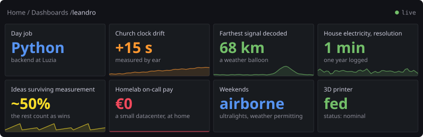

I'm Leandro. I write backend code in Python at [Luzia](https://www.luzia.com) and live in a village in Alicante, Spain. When something nearby catches my attention I instrument it, and a few weeks later there is a dashboard. This is the one about me:

<picture>
  <source media="(max-width: 600px)" srcset="assets/dashboard-narrow.svg">
  
</picture>

The longer versions are at [albero.dev](https://albero.dev).
