<picture>
  <source media="(max-width: 480px)" srcset="assets/man-narrow-bf9f3305.svg">
  <source media="(max-width: 720px)" srcset="assets/man-medium-0b5f3d70.svg">
  
</picture>

This is a real man page: [leandro.1](leandro.1). More at [albero.dev](https://albero.dev).

<details>
<summary>Plain text</summary>

```
LEANDRO(1)              User Commands             LEANDRO(1)

NAME
     leandro - backend engineer, measures things

SYNOPSIS
     leandro [idea ...]

DESCRIPTION
     Writes backend code at Luzia, mostly in Python.

     Given an idea, leandro instruments it, waits a few
     weeks and reports whether it was worth doing.  With no
     arguments, adds a sensor to something nearby.

EXIT STATUS
     0      The idea was worth it.

     1      The idea was not worth it and a graph was
            produced.  This is the common case and is not an
            error.

ENVIRONMENT
     HOME   A village in Alicante, Spain.

     TZ     Europe/Madrid.

     WEATHER
            Consulted before flying ultralights.  If unset,
            no flight is attempted.

FILES
     ~/homelab
            A small datacenter's worth of hardware, at home.

BUGS
     On call for everything in FILES, unpaid.

     The church clock next door runs about 15 seconds fast.
     This has been measured.

SEE ALSO
     https://albero.dev

Alicante, Spain          2026-11-26               LEANDRO(1)
```

</details>
