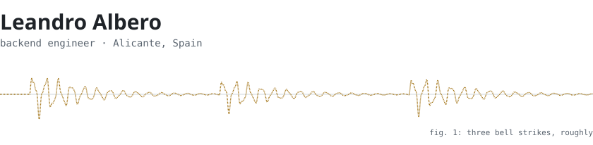

<a href="https://albero.dev">
  <picture>
    <source media="(prefers-color-scheme: dark)" srcset="assets/banner-dark.svg">
    
  </picture>
</a>

I work on the Python backend at [Luzia](https://www.luzia.com), a consumer AI assistant with 65M+ users across 40+ countries: messaging infrastructure, voice transcription pipelines that handle ~200K audio messages a day, and the occasional production fire.

Outside work I run a small datacenter's worth of self-hosted infrastructure at home and use it as a lab. About half the projects ended with the numbers telling me my clever idea wasn't worth it, and I count those as the successful ones. I also fly ultralights and feed a 3D printer.

<table>
  <tr>
    <td width="50%" valign="top">
      <h3>744B</h3>
      <b><a href="https://albero.dev/blog/744b-on-a-desktop">parameters on one RTX 3090</a></b> 
      GLM-5.2 on a desktop PC, streaming 21,504 experts from NVMe, at 0.06 tokens a second. The profiler says more RAM would not help.
    </td>
    <td width="50%" valign="top">
      <h3>15 s fast</h3>
      <b><a href="https://albero.dev/projects/campanar">my village's church clock, measured by ear</a></b> 
      Campanar listens to the tower around the clock, works out which bell struck, and trains a challenger model every night that only replaces the current one if it wins on evidence.
    </td>
  </tr>
</table>
<table>
  <tr>
    <td width="50%" valign="top">
      <h3>68 km</h3>
      <b><a href="https://albero.dev/blog/catching-a-weather-balloon">to a weather balloon</a></b> 
      A handheld whip, an RTL-SDR and 30 seconds of radiosonde signal, decoded into position, altitude and temperature.
    </td>
    <td width="50%" valign="top">
      <h3>€110 worse</h3>
      <b><a href="https://albero.dev/projects/ha-battery-mpc">than leaving the battery alone</a></b> 
      I wrote an interior-point LP solver to run my home battery on model-predictive control. A year of replayed data put it €110 to €170 a year behind plain self-consumption, so the battery runs self-consumption.
    </td>
  </tr>
</table>

The rest is pinned below and on [albero.dev](https://albero.dev). [Contact](https://albero.dev/contact) · [LinkedIn](https://www.linkedin.com/in/leandroalbero)
